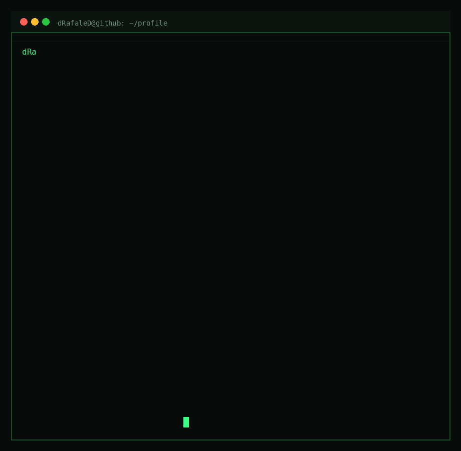

  <!-- The terminal uses assets/profile-terminal-mask.png, independent of the profile photo. -->
  
  
CYBERSECURITY &nbsp; / &nbsp; LINUX &nbsp; / &nbsp; SECURE SOFTWARE

## About

I am **Eren Erdogan**, a backend development student building practical tools for security research. My work spans static file analysis, phishing detection, OSINT, and secure software development.

I learn by building, investigating, and documenting what I find.

## Selected work

<table>
<tr>
<td width="50%" valign="top">
01 / OFFLINE ANALYSIS
<h3><a href="https://github.com/dRafaleD/Banshee">Banshee ↗</a></h3>

Pipe-friendly security analysis. Decode suspicious values, extract IOCs, inspect PE/ELF files, and preserve verifiable evidence bundles.

Rust · YARA · Alpha

</td>
<td width="50%" valign="top">
02 / STATIC MALWARE TRIAGE
<h3><a href="https://github.com/dRafaleD/Malware-analysis-AsphDex">AsphDex ↗</a></h3>

PE/ELF inspection, strings, entropy, YARA matches, and explainable reports, without intentionally executing the sample.

Electron · JavaScript · Rust · YARA

</td>
</tr>
<tr>
<td width="50%" valign="top">
03 / EMAIL SECURITY
<h3><a href="https://github.com/dRafaleD/FhniX">FhniX ↗</a></h3>

Local phishing email triage with transparent rule scoring, an optional local classifier, and read-only IMAP scans. Links stay defanged.

Python · Desktop & CLI

</td>
<td width="50%" valign="top">
04 / DIGITAL FOOTPRINT
<h3><a href="https://github.com/dRafaleD/The-Trackher">The-Trackher ↗</a></h3>

Username and email OSINT for your own accounts, breach exposure checks, and local trace cleanup with dry-run support.

Python · Privacy & OSINT

</td>
</tr>
</table>

[Explore all repositories →](https://github.com/dRafaleD?tab=repositories)

## Current focus

| Investigate | Build | Learn |
| :--- | :--- | :--- |
| Static malware analysis & reverse engineering | Local security tools with explainable results | Advanced web application security |
| OSINT & digital-footprint research | Secure backend services & APIs | Linux hardening & network security |

## Tools & credentials

<strong>Languages, databases & platforms</strong>

  

<strong>Security toolkit</strong>

  
   Highlighted tools are the ones I use the most.

<strong>Certifications — Siber Vatan & Cisco</strong>

<table align="center">
<tr>
<td align="center">
 
Verified certificate
</td>
<td align="center">
 
Introduction to Cybersecurity
</td>
<td align="center">
 
Network Defense
</td>
<td align="center">
 
Cyber Threat Management
</td>
</tr>
</table>

## Community

[XERJ Corpus Hub contributor ↗](https://hub.xerj.org/contributors/dRafaleD.html)

## Activity

GitHub contribution streak

---

**Research responsibly. Build carefully.** All security research and testing is performed in authorized environments only.

[Portfolio](https://drafaled.github.io/) &nbsp; · &nbsp; [LinkedIn](https://www.linkedin.com/in/eren-erdo%C4%9Fan-655084399/) &nbsp; · &nbsp; [GitHub repositories](https://github.com/dRafaleD?tab=repositories)
