  

## About

I am Eren Erdoğan, a backend development student focused on cybersecurity, Linux systems, and secure software development. I build practical tools while improving my skills in penetration testing, OSINT, malware analysis, reverse engineering, and full-stack development.

<a href="https://github.com/dRafaleD/Banshee"><strong>Banshee ↗</strong></a> &nbsp; · &nbsp;
<a href="https://github.com/dRafaleD/Malware-analysis-AsphDex"><strong>AsphDex ↗</strong></a> &nbsp; · &nbsp;
<a href="https://github.com/dRafaleD/FhniX"><strong>FhniX ↗</strong></a> &nbsp; · &nbsp;
<a href="https://github.com/dRafaleD/The-Trackher"><strong>The-Trackher ↗</strong></a>

  

  

  

## Certifications

<table align="center">
<tr>
<td align="center">
 
Verified certificate
</td>
<td align="center">
 
Introduction to Cybersecurity
</td>
<td align="center">
 
Network Defense
</td>
<td align="center">
 
Cyber Threat Management
</td>
</tr>
</table>

## Community Contributions

## Ethics

 

<strong>Explore responsibly · Report ethically · Strengthen securely</strong> 
All security research and testing is performed in authorized environments only.

## Connect

## GitHub Activity

 

