  <!-- The terminal uses assets/profile-terminal-mask.png, independent of the profile photo. -->
  
  

<a href="https://github.com/dRafaleD/Banshee"><strong>Banshee ↗</strong></a> &nbsp; · &nbsp;
<a href="https://github.com/dRafaleD/Malware-analysis-AsphDex"><strong>AsphDex ↗</strong></a> &nbsp; · &nbsp;
<a href="https://github.com/dRafaleD/FhniX"><strong>FhniX ↗</strong></a> &nbsp; · &nbsp;
<a href="https://github.com/dRafaleD/The-Trackher"><strong>The-Trackher ↗</strong></a> &nbsp; · &nbsp;
<a href="https://github.com/dRafaleD/sentinel-security"><strong>sentinel-security ↗</strong></a> &nbsp; · &nbsp;
<a href="https://github.com/dRafaleD/flowscope"><strong>flowscope ↗</strong></a>

More satellites & security labs in orbit

- [**DuckGuard**](https://github.com/dRafaleD/DuckGuard) — Rust CLI for Dockerfile, Compose & running-container security checks
- [**cybersec-skills**](https://github.com/dRafaleD/cybersec-skills) — Token-efficient defensive Agent Skills
- [**dRafaleD.github.io**](https://drafaled.github.io) — Personal portfolio for cybersecurity & backend engineering
- **Hands-on Security Labs:** [Reverse Engineering](https://github.com/dRafaleD/Reverse-Engineering-Labs) · [Malware Analysis](https://github.com/dRafaleD/Malware-Analysis-Labs) · [Digital Forensics](https://github.com/dRafaleD/Digital-Forensics-Labs) · [Network Security](https://github.com/dRafaleD/Network-Security-Labs) · [Web Security](https://github.com/dRafaleD/Web-Security-Labs) · [YARA](https://github.com/dRafaleD/YARA-Learning-Labs) · [Windows Internals](https://github.com/dRafaleD/Windows-Internals-Labs) · [Cloud Security](https://github.com/dRafaleD/Cloud-Security-Labs) · [AI Security](https://github.com/dRafaleD/AI-Security-Labs)

  

  

  

Original credential badges and verification links

<table align="center">
<tr>
<td align="center">
 
Verified certificate
</td>
<td align="center">
 
Introduction to Cybersecurity
</td>
<td align="center">
 
Network Defense
</td>
<td align="center">
 
Cyber Threat Management
</td>
</tr>
</table>

Live contributor badge

  
  &nbsp;
  

 

