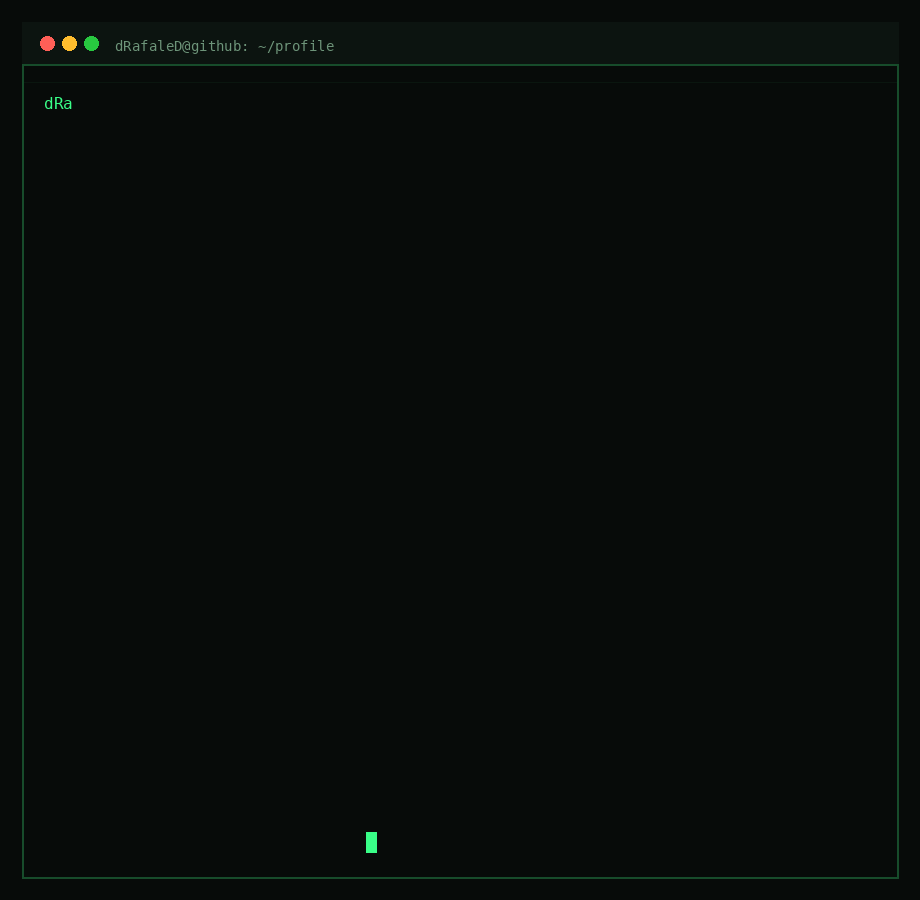
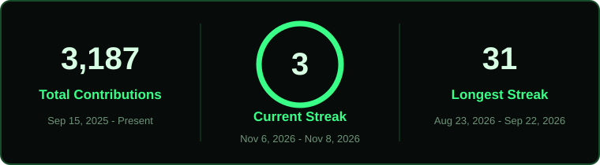

  
  

## About

I am Eren Erdogan, a backend development student focused on cybersecurity, Linux systems, and secure software development. I build practical tools while improving my skills in penetration testing, OSINT, malware analysis, reverse engineering, and full-stack development.

## Technical Arsenal

  

## Security Toolkit

  

## Security Focus

- Web application security and penetration testing
- Vulnerability assessment and secure-code review
- OSINT and digital-footprint security
- Malware analysis, reverse engineering, and binary analysis
- Cryptography fundamentals and applied security concepts
- Linux systems, network security, automation, and secure backend development

## Currently Learning

- Advanced web application security
- Malware analysis and reverse engineering
- Linux hardening and network security
- Secure API and backend architecture

## Certifications

<table align="center">
<tr>
<td align="center">
 
Verified certificate
</td>
<td align="center">
 
Introduction to Cybersecurity
</td>
<td align="center">
 
Network Defense
</td>
<td align="center">
 
Cyber Threat Management
</td>
</tr>
</table>

## Community Contributions

## Selected Projects

| Project | Description | Stack |
| --- | --- | --- |
| [Banshee](https://github.com/dRafaleD/Banshee) | Offline, pipe-friendly security analysis toolkit (alpha). Decodes suspicious values, extracts IOCs, inspects PE/ELF metadata, applies local rules and preserves results in verifiable evidence bundles, all without uploading your inputs. | Rust · YARA |
| [AsphDex](https://github.com/dRafaleD/Malware-analysis-AsphDex) | Defensive static malware triage for Windows and Linux (release candidate). PE/ELF analysis, strings, entropy, YARA and IOC extraction with explainable reports, without intentionally executing the sample. | Electron · JavaScript · Rust · YARA |
| [FhniX](https://github.com/dRafaleD/FhniX) | Explainable, local-first phishing email triage. Transparent rule scoring with an optional local Naive Bayes model, desktop GUI and CLI, folder reports and read-only IMAP scans. Links are defanged and never visited. | Python |
| [The-Trackher](https://github.com/dRafaleD/The-Trackher) | Digital-footprint and privacy toolkit with CLI and GUI. Username and email OSINT for your own accounts, breach exposure checks and local trace cleanup with dry-run support. | Python |

## Ethics

 

<strong>Explore responsibly · Report ethically · Strengthen securely</strong> 
All security research and testing is performed in authorized environments only.

## Connect

## GitHub Activity

 

