  <!-- The terminal uses assets/profile-terminal-mask.png, independent of the profile photo. -->
  

## About

I am **Eren Erdogan**, a backend development student building practical tools for security research. My work spans static file analysis, phishing detection, OSINT, and secure software development.

I learn by building, investigating, and documenting what I find.

## Research atlas

<a href="https://github.com/dRafaleD/Banshee">Banshee ↗</a> &nbsp; · &nbsp;
<a href="https://github.com/dRafaleD/Malware-analysis-AsphDex">AsphDex ↗</a> &nbsp; · &nbsp;
<a href="https://github.com/dRafaleD/FhniX">FhniX ↗</a> &nbsp; · &nbsp;
<a href="https://github.com/dRafaleD/The-Trackher">The-Trackher ↗</a>

## Current focus

| Investigate | Build | Learn |
| :--- | :--- | :--- |
| Static malware analysis & reverse engineering | Local security tools with explainable results | Advanced web application security |
| OSINT & digital-footprint research | Secure backend services & APIs | Linux hardening & network security |

## Engineering & investigation

## Certifications

<table align="center">
<tr>
<td align="center">
 
Verified certificate
</td>
<td align="center">
 
Introduction to Cybersecurity
</td>
<td align="center">
 
Network Defense
</td>
<td align="center">
 
Cyber Threat Management
</td>
</tr>
</table>

## Community

[XERJ Corpus Hub contributor ↗](https://hub.xerj.org/contributors/dRafaleD.html)

## Activity

---

**Research responsibly. Build carefully.** All security research and testing is performed in authorized environments only.

[Portfolio](https://drafaled.github.io/) &nbsp; · &nbsp; [LinkedIn](https://www.linkedin.com/in/eren-erdo%C4%9Fan-655084399/) &nbsp; · &nbsp; [GitHub repositories](https://github.com/dRafaleD?tab=repositories)
