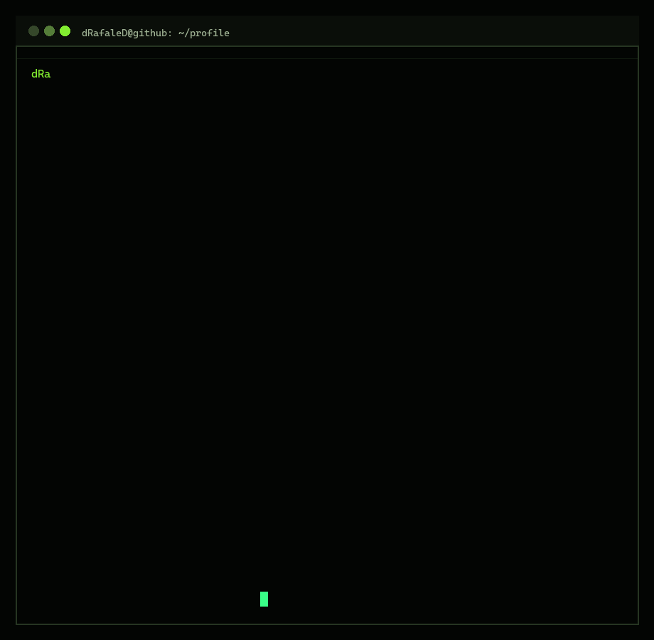
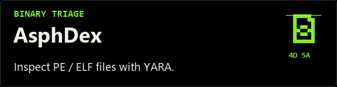
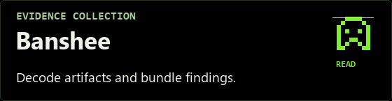
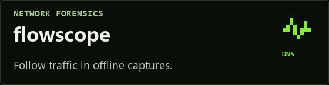
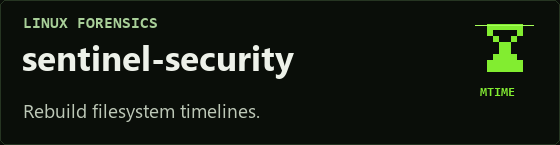
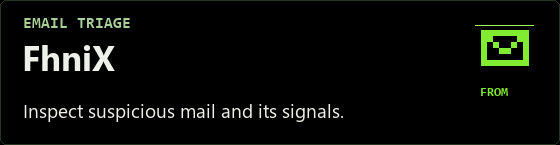
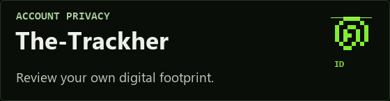
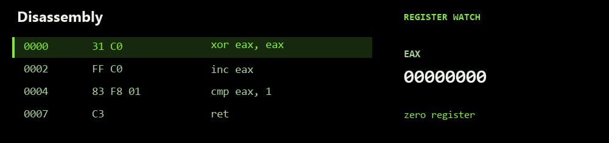

<picture>
  <source media="(prefers-reduced-motion: reduce)" srcset="assets/operator-terminal.png" />
  
</picture>

<picture>
  <source media="(prefers-reduced-motion: reduce)" srcset="assets/lab-console.png?v=14" />
  
</picture>

[Projects](#projects) · [Stack & tools](#stack-and-tools) · [Training](#training-and-community) · [Activity](#activity) · [Malware lab](#malware-analysis-lab) · [Contact](#contact)

## Projects

Open a project to explore its source.

<a href="https://github.com/dRafaleD/Malware-analysis-AsphDex"><picture><source media="(prefers-reduced-motion: reduce)" srcset="assets/trace-asphdex.png" /></picture></a>
<a href="https://github.com/dRafaleD/Banshee"><picture><source media="(prefers-reduced-motion: reduce)" srcset="assets/trace-banshee.png" /></picture></a>

<a href="https://github.com/dRafaleD/flowscope"><picture><source media="(prefers-reduced-motion: reduce)" srcset="assets/trace-flowscope.png" /></picture></a>
<a href="https://github.com/dRafaleD/sentinel-security"><picture><source media="(prefers-reduced-motion: reduce)" srcset="assets/trace-sentinel.png" /></picture></a>

<a href="https://github.com/dRafaleD/FhniX"><picture><source media="(prefers-reduced-motion: reduce)" srcset="assets/trace-fhnix.png" /></picture></a>
<a href="https://github.com/dRafaleD/The-Trackher"><picture><source media="(prefers-reduced-motion: reduce)" srcset="assets/trace-trackher.png" /></picture></a>

More repositories & security labs

- [**DuckGuard**](https://github.com/dRafaleD/DuckGuard) — Rust CLI for Dockerfile, Compose & running-container security checks
- [**cybersec-skills**](https://github.com/dRafaleD/cybersec-skills) — Token-efficient defensive Agent Skills
- [**dRafaleD.github.io**](https://drafaled.github.io) — Personal portfolio for cybersecurity & backend engineering
- **Hands-on Security Labs:** [Reverse Engineering](https://github.com/dRafaleD/Reverse-Engineering-Labs) · [Malware Analysis](https://github.com/dRafaleD/Malware-Analysis-Labs) · [Digital Forensics](https://github.com/dRafaleD/Digital-Forensics-Labs) · [Network Security](https://github.com/dRafaleD/Network-Security-Labs) · [Web Security](https://github.com/dRafaleD/Web-Security-Labs) · [YARA](https://github.com/dRafaleD/YARA-Learning-Labs) · [Windows Internals](https://github.com/dRafaleD/Windows-Internals-Labs) · [Cloud Security](https://github.com/dRafaleD/Cloud-Security-Labs) · [AI Security](https://github.com/dRafaleD/AI-Security-Labs)

## Stack and tools

<picture>
  <source media="(prefers-reduced-motion: reduce)" srcset="assets/lab-byte-trace.png?v=14" />
  
</picture>

  

  

  

## Training and community

Original credential badges and verification links

<table align="center">
<tr>
<td align="center">
 
Verified certificate
</td>
<td align="center">
 
Introduction to Cybersecurity
</td>
<td align="center">
 
Network Defense
</td>
<td align="center">
 
Cyber Threat Management
</td>
</tr>
</table>

Live contributor badge

## Activity

 

## Malware analysis lab

<picture>
  <source media="(prefers-reduced-motion: reduce)" srcset="assets/malware-beetle.png?v=2" />
  
</picture>

<picture>
  <source media="(prefers-reduced-motion: reduce)" srcset="assets/instruction-trace.png" />
  
</picture>

## Contact

  
  &nbsp;
  

